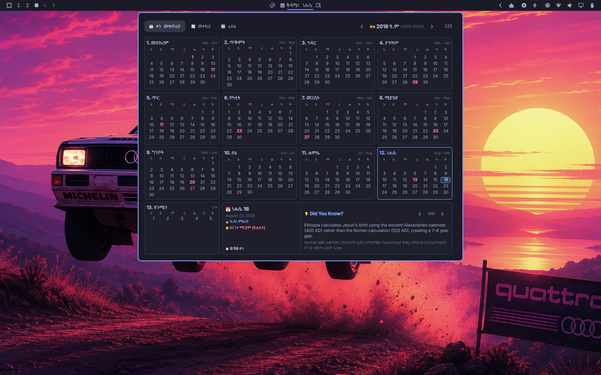

# 🇪🇹 Ethiopian Calendar & Fidel Suite for Omarchy

An authentic, comprehensive, and beautifully themed Ethiopian Calendar and cultural suite designed specifically for the **Omarchy Linux Desktop (Quattro Shell)**.



---

## ✨ Features

### 🗓️ 1. Complete 13-Month Year Poster Calendar
- **Full Year Overview**: Displays all 13 Ethiopian months side-by-side in a responsive 4-column poster grid.
- **13 Months of Sunshine**: Exact handling of 12 thirty-day months plus *Pagumē* (5 days in standard years, 6 days in leap years).
- **Dual Calendar Spanning**: Each month header displays its corresponding Gregorian month span (e.g., *Sep – Oct*).
- **Interactive Day Selection**: Click any day cell across the year to inspect its detailed metadata in the bottom dashboard.
- **Ge'ez Numerals Toggle (`፩፪፫` / `123`)**: Instant toggle between ancient Ge'ez numerals (`፩, ፪, ፫ ... ፳፻፲፰`) and Western Arabic numerals.
- **Year Navigation**: Browse past and future Ethiopian years with high-visibility `‹` and `›` controls.

### 🔄 2. Bi-directional Gregorian ⇄ Ethiopian Converter
- **Two-Way Date Calculator**: Convert seamlessly from Gregorian to Ethiopian or Ethiopian to Gregorian.
- **Typable & Stepper Inputs**: Type exact years, months, and days directly or adjust them via `-`/`+` and `‹`/`›` stepper buttons.
- **Auto-Syncing Month Labels**: Live month names update dynamically as you type numbers (e.g., `11` ➔ *ሐምሌ / July*).
- **One-Click Date Copying**: Copy formatted converted dates directly to the system clipboard with desktop notification feedback.
- **Instant "Today" (ዛሬ) Shortcut**: Reset calculations to the current date in a single click.

### 🔤 3. Interactive Amharic Fidel & Numeral Chart
- **33 Consonant Families × 7 Vowel Orders**: Complete traditional *Abugida* chart with Latin phonetics.
- **21 Labialized Diphthongs (ዲቃላ ፊደላት)**: Phonetic guide for compound sounds (`ሏ, ሟ, ሯ, ሷ ...`).
- **Ge'ez Numerals (ቁጥሮች)**: Quick reference table mapping Ge'ez digits (`፩`–`፻`) to their numerical values.
- **1-Click Copy**: Click any character to immediately copy it to the clipboard with native desktop notification.

### ⛪ 4. Orthodox Holidays & Daily Saint Commemorations
- **Public & Orthodox Holidays**: Dot indicators and badges for major Ethiopian holidays (*እንቁጣጣሽ, መስቀል, ገና, ጥምቀት, የዐድዋ ድል በዓል, ደብረ ታቦር / ቡሄ, ፍልሰታ*).
- **Daily Saint (የዕለቱ ታቦት)**: Displays the daily Ethiopian Orthodox saint or angel commemoration (e.g., *ሚካኤል, ማርያም, ጊዮርጊስ, ተክለ ሃይማኖት, መድኃኔዓለም*).

### ⏰ 5. Traditional 12-Hour Sunrise Clock
- **Equatorial Dawn-to-Dusk Time**: Converts system time into traditional Ethiopian 12-hour clock based on sunrise (*6:00 AM = 12:00 ንጋት*).
- Displays live hour, minute, and period indicator (*ቀን / ማታ*).

### 💡 6. Curated Cultural Facts ("Did You Know?")
- 14 concise, educational facts covering calendar history (why Ethiopia is 7–8 years behind the West), sunrise time calculations, the Ge'ez script, coffee origins, fossil history (*Lucy / Dinknesh*), monolithic architecture (*Lalibela*), and endemic wildlife.

### 🎨 7. Pure Omarchy Theme Integration
- **Zero Hardcoded Colors**: Strictly inherits Quattro theme tokens (`Color.popups.text`, `Color.popups.background`, `Color.accent`, `Color.urgent`, `Style.font`).
- **Native Wayland Popup / Overlay**: Powered by Quickshell for fluid 60fps rendering with zero CPU overhead.

---

## ⌨️ Keyboard Shortcuts

When the calendar popup is open:

| Key | Action |
| :--- | :--- |
| <kbd>1</kbd> | Switch to **Calendar View** (🗓️ ቀን መቁጠሪያ) |
| <kbd>2</kbd> | Switch to **Converter View** (🔄 መቀየሪያ) |
| <kbd>3</kbd> | Switch to **Fidel Chart View** (🔤 ፊደል) |
| <kbd>T</kbd> | Reset view to **Today** (ዛሬ) |
| <kbd>N</kbd> | Toggle **Ge'ez / Arabic Numerals** (፩፪፫ ⇄ 123) |
| <kbd>←</kbd> | Navigate to **Previous Year** |
| <kbd>→</kbd> | Navigate to **Next Year** |
| <kbd>C</kbd> | **Copy Selected Date** to clipboard |
| <kbd>Esc</kbd> | Unfocus input or **Close Panel** |

---

## 🏷️ Bar Widget Formats

Right-click the bar widget at any time to cycle between 4 different date/time display modes:

1. **Medium Ge'ez (Default)**: `ቅዳሜ፣ ነሐሴ ፲፮`
2. **Full with Year**: `ቅዳሜ፣ ነሐሴ ፲፮ ፳፻፲፰`
3. **Date with Live Ethiopian Time**: `ነሐሴ ፲፮ · 4:59 ቀን`
4. **Western Arabic Numerals**: `ቅዳሜ፣ ነሐሴ 16, 2018`

---

## 🚀 Installation

### Via Omarchy Plugin Marketplace (Recommended)
Search for **"Ethiopian Calendar"** in the Omarchy Marketplace catalog and click **Install**.

### CLI / Manual Installation
1. Install using the Omarchy CLI:
   ```bash
   omarchy plugin add https://github.com/yaredow/omarchy-ethiopian-calendar.git --enable
   ```
2. Or clone directly into your Omarchy plugins directory:
   ```bash
   git clone https://github.com/yaredow/omarchy-ethiopian-calendar.git ~/.config/omarchy/plugins/user.ethiopian-calendar
   ```
3. Rescan and restart the Omarchy Quattro shell:
   ```bash
   omarchy-restart-shell
   ```

---

## 🗑️ Removal & Uninstallation

### Via Omarchy CLI
```bash
omarchy plugin remove user.ethiopian-calendar
```

### Manual Removal
1. Delete the plugin directory:
   ```bash
   rm -rf ~/.config/omarchy/plugins/user.ethiopian-calendar
   ```
2. Restart the Omarchy Quattro shell:
   ```bash
   omarchy-restart-shell
   ```

---

## 📄 License

Distributed under the **MIT License**. See [LICENSE](LICENSE) for more information.
